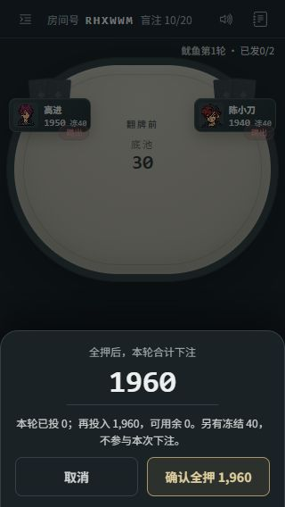
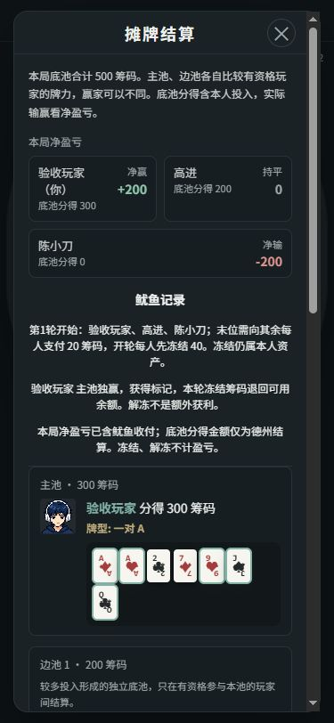
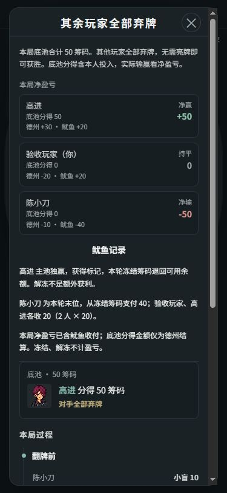
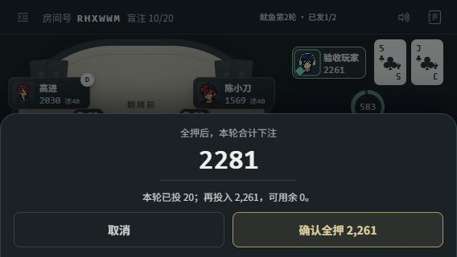

# 行动金额与结算说明优化 · 2026-10-26

基线为本地连接修复 `5cf462a`；分支 `codex/action-result-clarity`。本轮及上一轮连接修复均尚未推送、合并或部署；线上仍为 `63f9fde`。没有修改托管资源或费用设置。

## 本轮范围

- 跟注提示说明本次还需投入多少、跟注后可用多少。
- 加注面板区分“本轮合计下注到”与“本次新增投入”，同步显示剩余可用筹码；冻结筹码单独说明，不参与本次下注。
- 直接全押、全押跟注先进入既有下注面板确认；取消不发送。条件变化或断开后，旧确认失效。普通加注面板选到全押时，确认按钮明确写出本次全押金额。
- 取消全押后再打开普通加注，不继承全押上限；取消和 Esc 返回入口焦点。
- 滑条精确到整数筹码，加减按钮仍按大盲步进。空值、小数不可确认，避免静默截断为另一金额。
- 弃牌确认绑定本次行动；同一行动中的普通状态广播不再重置确认，换局/换金额或 2.5 秒到期则取消。
- 结算区分底池到账与净盈亏；主池/边池金额与赢家分别说明，平分展示各人实分与零头规则。
- 鱿鱼支付时逐人拆出德州净盈亏和鱿鱼净收付，解释冻结仍属本人资产、解冻不增加利润。

只改客户端表达与操作确认，没有修改服务端下注规则、身份校验、筹码分配或付费资源。
新增 `public/poker-explanations.js`，必须随 HTML 和 client.js 一起发布。

## 金额口径

- 本次跟注 = min(可用筹码, max(0, 当前最高下注 − 本轮已投))。
- 本次加注新增投入 = 本轮加注到 − 本轮已投；操作后可用 = 当前可用 − 新增投入。
- 德州净盈亏 = 服务端本手总净盈亏 − 本手鱿鱼净收付。
- 底池分得逐池累加服务端 `amountWon`，不按人数重算平分，保留服务端零头结果；历史缺失个人分配时明确提示未记录。

## 实际检查

- `node test/action-result.test.js` 通过：执行生产金额帮助函数及真实客户端操作函数，覆盖全押确认/取消/条件变化/离线、全押跟注语义、不足额加注权限、非整盲金额、空值/小数拒绝、普通广播不打断弃牌确认、边池与鱿鱼分解。
- `node test/ui-content.test.js` 通过，包含新脚本加载顺序。
- `node test/room-connection.test.js` 通过，未破坏上一轮的请求保护。
- `node test/rules.test.js` 25 项通过，`node test/squid.test.js` 通过；使用主目录已有依赖设置 NODE_PATH，没有安装或更新依赖。之后的输入校验/展示微调不改变服务端规则，未重复运行这两项。
- `node --check public/client.js`、`git diff --check` 通过。
- 未运行全量 npm test。

浏览器使用隔离夹具 `test/squid-ui-fixture.js`，随机端口 57017，3 人鱿鱼房间；没有操作线上房间。验收后页面已关闭，浏览器尺寸已恢复，服务端口已确认停止监听。

## 浏览器验收场景

1. 375×812、320×568：全押入口只打开确认，状态仍为原可用 1960、冻结 40；取消不扣筹码。再次普通加注起点为最小 40，而非全押上限。
2. 320×568：输入 333，输入框、滑条、确认按钮一致；实际发送后可用 1960−333=1627，冻结仍为 40。
3. 用夹具 `review sidepots` 固定合法牌面及整数投入，再调用生产摊牌函数：主池 300 给本人、边池 200 给高进；净盈亏分别 +200、0、−200。夹具直接准备场景，之前的行动时间线不代表这一组受控投入。
4. 下一手用真实弃牌动作使高进获得本轮第二个不同标记：陈小刀支付 40，另外两人各收 20。本人“德州 −20、鱿鱼 +20、合计 0”；高进 +30+20=+50；陈小刀 −10−40=−50，三人合计 0。
5. `review split`：303 底池由服务端分成 152 和 151；页面未显示成每人 151.5，实际净盈亏 +51、+50、−101。
6. 568×320：全押 2211 确认后，实际可用 0、冻结 40、本轮投入 2211；后续另一手已投入 20 时，面板显示本轮合计 2281、再投入 2261，并成功取消。

截图为 JPEG，已按实际格式保存；375/320/568 文件尺寸分别核对为 375×812、320×568、568×320。原生横屏截图曾返回错误缩放图，已弃用并改用与 DOM 实测一致的截图接口；`10-landscape-action.jpg` 为确认层出现前的行动画面，最终确认层证据为 11。05/06 是鱿鱼长段落左对齐前的中间画面，金额展示未变；07/11 为对应最终画面。

## 未覆盖的限制

这是桌面浏览器模拟视口，未验证手机真机、输入法键盘、触控误触率或半小时真人局。服务器重启仍会清空房间。本轮没有新增观战、账号、持久化或新玩法。
