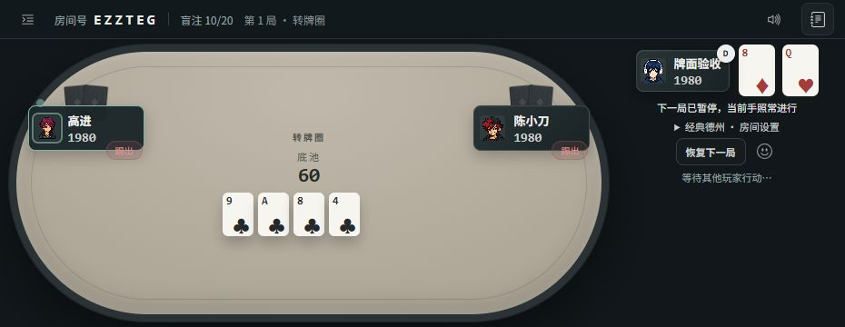
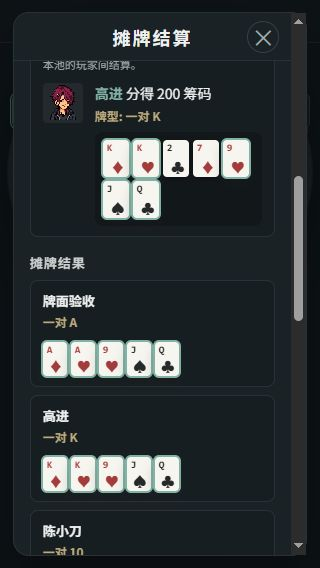

# 手机小牌面重叠修复 · 2026-10-26

基线 main：`857856317e7c3fc7d5273cf007c2609c0209b00f`。分支：`codex/fix-compact-card-faces`。
本轮仅本地修复、验收与提交，尚未合并或发布。

## 问题与修改

用户截图中，横屏公共牌缩到 34×48，但仍同时显示左上和右下两组点数/小花色、中央大花色，导致单张牌内部互压。宽于 900px 的低高度横屏还会继承桌面 27px 中央花色，而牌张已经缩小。

仅修改 public/style.css：手机竖屏与低高度横屏采用左上点数、右下单一花色，隐藏重复角标及小花色；横屏小牌明确使用 12px 点数和 19px 花色。牌张尺寸、牌间距、牌局逻辑与发牌数据保持原值。复盘迷你牌同样采用单组标记，桌面大牌样式保持原值。

## 实际检查

复用既有 test/squid-ui-fixture.js，隔离服务随机端口 55167，创建 3 人经典房间推进到翻牌/转牌并使用 review sidepots 检查复盘。

- 930×360（对应用户截图尺寸附近）、568×320：公共牌和本人手牌的点数与花色文本范围无相交。
- 375×812、320×568：同样通过。
- 320×568 复盘：44 张有布局尺寸的牌面，文本范围相交为 0；包括背景牌桌与可滚动复盘内容。
- 1280×800：33 张迷你牌文本范围相交为 0。桌面大牌未纳入“无相交”的结论，因为本轮未更改桌面大牌的原有排版。
- measurements.json 为实际 DOM 与字符 Range 边界记录；字符文本范围是近似指标，已结合截图检查。
- node test/ui-content.test.js、git diff --check 通过。纯样式改动，没有新增测试、安装工具或运行完整规则测试。

930px 横屏检查前主动收起了日志，匹配用户截图的状态。初始日志展开时会挤压牌桌宽度，这是另一个布局问题，本轮未修改。因其使牌面移到屏外，初始截图已弃用，不作为修复前后对照。

其余尺寸见 after-568.jpg、after-375.jpg、after-320.jpg。截图为浏览器模拟尺寸，不代表手机真机字体与微信内核已验证。

检查完成后已恢复浏览器尺寸、关闭测试页和隔离服务；未操作线上牌局。之前讨论的微信页内横屏、全屏入口和地址栏遮挡适配尚未实施。
