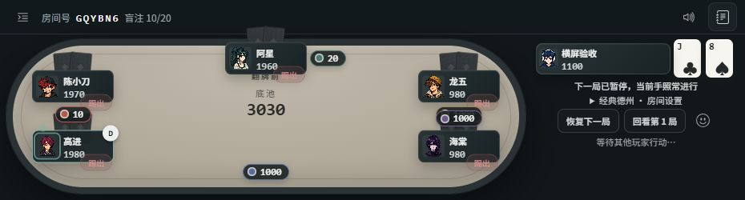
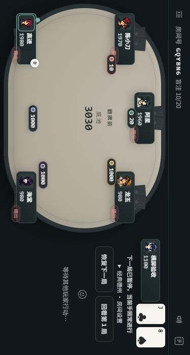
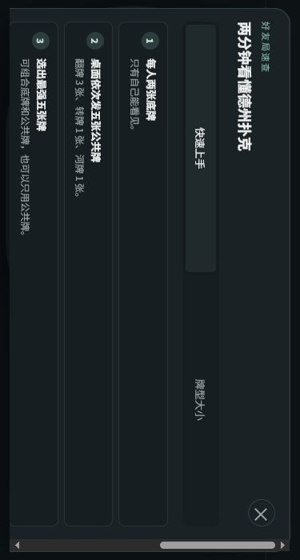

# 手机显示模式与横屏遮挡修复 · 2026-10-26

基于未发布的小牌修复 `5763caf`，分支 `codex/mobile-game-view`。本轮仅本地实现和验收，尚未推送、合并或部署；线上仍是 PR #6 的 `8578563`。

## 使用方式

进入房间后，打开左上菜单：

- **横向牌桌**：竖屏窗口内把整个游戏横向显示，系统不允许转屏时也可尝试；再次选择“恢复自动布局”退出。只变换现有页面，不刷新、不新建 Socket。
- **全屏游戏**：由用户点击申请浏览器全屏；进入后菜单切换为“退出全屏”。不支持或拒绝时给出提示，牌局保持。
- 页内横向时，输入框获得焦点会临时回到自然方向，结束编辑后恢复横向；聊天和下注草稿保留。真实软键盘和微信内核仍需真机复核。

## 修改

- 新增 mobile-view.js：跟随 visualViewport 的尺寸/偏移，缺少该 API 时使用 innerWidth/innerHeight；管理全屏、手动横向、输入焦点与显示尺寸。
- 新增 mobile-view.css：原生及页内横向共用紧凑布局；日志改为浮层，进入紧凑布局默认收起，避免超过 900px 的横屏窗口套用电脑侧栏而压扁牌桌。
- 页面 wrapper 同时包含牌桌、聊天、玩法、设置、结算和断线弹窗；旋转时弹窗仍按逻辑显示区域限制高度。安全区变量按旋转方向对应，不改变实际游戏数据。
- seatPosition 使用逻辑显示尺寸；renderBets 将所有视口矩形统一逆变换到逻辑坐标，继续使用原避让算法，避免只旋转外观而错放下注标签。
- 保留之前的小牌排版修复，没有修改服务端玩法、权限、筹码分配或房间连接协议。

## 本次检查

- node test/mobile-view.test.js 通过：90°矩形转换、可见区域、方向偏好、输入临时恢复、键盘挤压不误判横屏、退出大厅、缺少 visualViewport、标准/旧式全屏进入退出、缺失/拒绝。
- 新增旧式全屏测试曾发现退出接口配对问题；已修正并复测通过。
- node test/geometry-check.js 通过：四布局×2–6人×全席位，以及生产 renderBets 的 DOM 夹具。角度/避让参数未调整。
- action-result、ui-content、room-connection 检查通过；脚本语法和 git diff --check 通过。
- room-connection.integration 检查通过：6人经典、3人鱿鱼各6手，共12次回座、129次真实本机行动。
- 未运行全量 npm test。没有安装或更新依赖。

浏览器使用已有 squid-ui-fixture.js，随机端口 56195，6人经典房间；没有操作线上服务或真实用户房间。

1. **930×250**：模拟地址栏占用后的低高度窗口。牌桌 648×193，全部行动按钮位于 y=120–210；全押按钮底边 210，未超过可见高度250。
2. 日志展开前后牌桌宽度均为648，不再被侧栏挤压；日志以可关闭浮层显示，主动展开时会覆盖部分牌桌。
3. **375×700 页内横向**：现有6人局直接旋转，玩法弹窗处于屏幕范围内；点开下注，输入333时暂回竖屏，确认后恢复横向，服务端下注333；标签仍在桌内。
4. 聊天输入“旋转时保留的聊天草稿”，切换焦点恢复横向后原文仍在，没有发送该草稿。
5. 实际点击全屏后菜单显示“退出全屏”，退出后恢复“全屏游戏”；房号、手牌、公共牌和底池快照保持一致。独立自动/横向切换往返也保持同一快照。
6. **320×568 页内横向 vs 568×320 自然横屏**：牌桌、公共牌、本人手牌区域和333下注标签的逻辑矩形一致。见 rotation-layouts.json；隐藏操作区的零尺寸矩形不作位置比较。
7. 最终代码下六人长下注：从旋转界面跟注1000，服务端确认本人从2100变为1100，本轮投入1000。自然横屏与页内横向均检查。

其他画面和尺寸记录在本目录。图片是模拟视口，未验证真实微信、手机软键盘、刘海/手势区域或系统全屏限制；不能据此承诺所有手机都支持原生全屏。页面内横向不隐藏微信自身顶栏。

验收结束已恢复浏览器尺寸、关闭页面和服务，56195端口已停止监听。

## 后续发布

用户需明确授权合并上线。应一起发布小牌修复及本轮修改，新增 mobile-view.css 和 mobile-view.js 必须与 HTML/client.js 同版本核验。既有托管仍为 Render Free，自动部署关闭；本轮没有改动托管、计费或定时任务。
