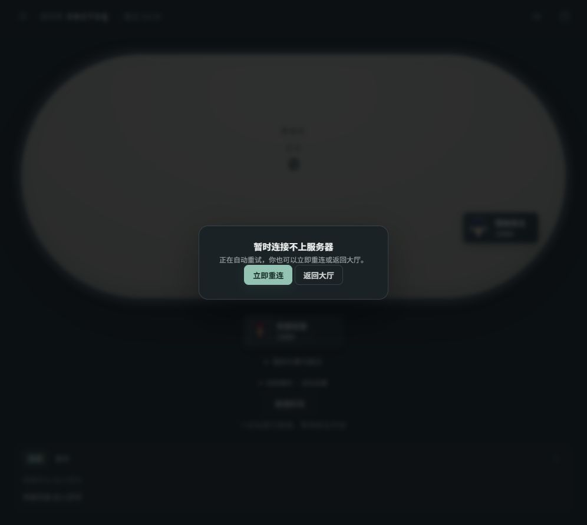
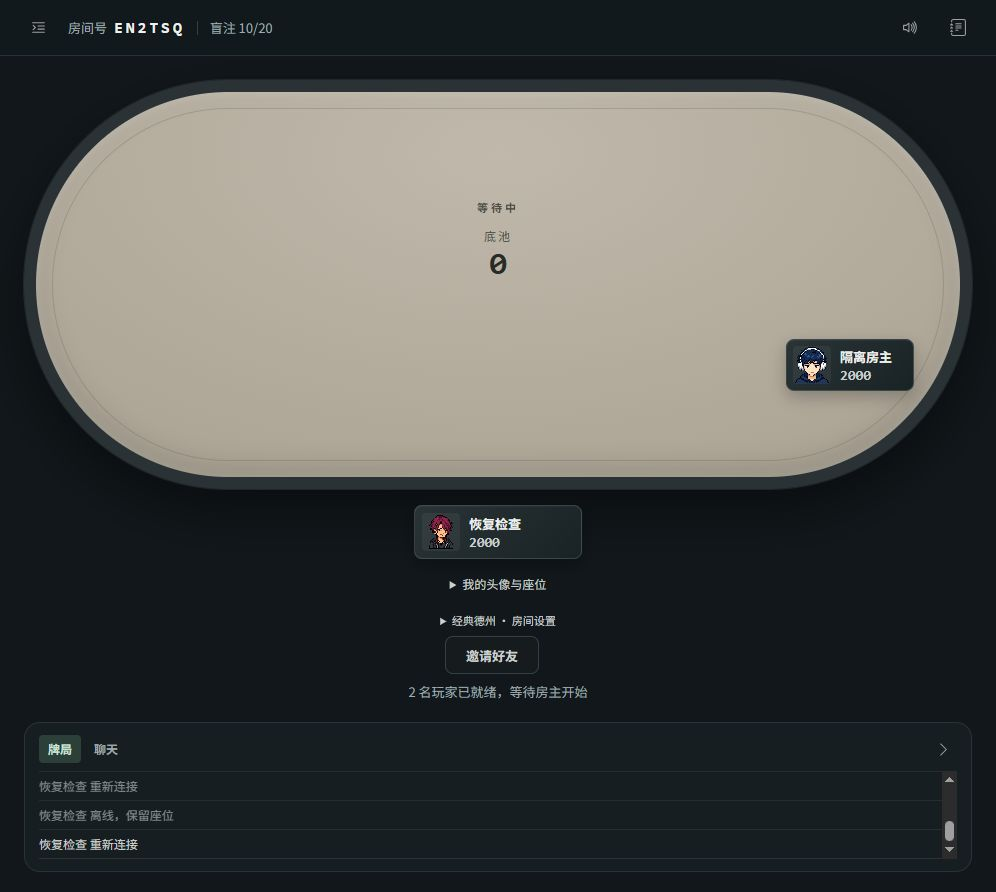

# 朋友局连接可靠性修复 · 2026-10-26

基线：main `63f9fdee709cd80b6528f10110ff972d9beb7a68`。工作分支：`codex/room-recovery`。

本轮完成本地优化与验证，尚未推送、合并或部署。线上仍为此前发布版本。本轮没有修改 Render、计费或资源配置。

## 已处理问题

- 原自动回座 `join_room` 没有回执等待时限；连接成功但回执丢失时，可能一直停在恢复遮罩。
- 原恢复重试未取消旧计时器/回执；反复断开、退出等情况下旧请求可能继续影响界面。
- 原下注使用普通 emit，离线点击可能在 Socket.IO 中排队；3 秒等待样式兜底也未隔离旧请求与新请求。

新增 `public/room-connection.js`，负责有限恢复及下注请求生命周期，不修改服务端身份校验、保护窗口或牌局规则。

恢复每次最多等 8 秒，间隔 1.5 秒，最多尝试 3 次，随后显示手动重试/返回大厅；传输断开或连接失败时也立即保留手动入口。
恢复必须收到原房号、本人座位和昵称匹配的 state；只有成功回执不解除遮罩。收到本人状态后，即使回执丢失也能恢复。
重试始终携带本地原凭证；缺凭证时不能以新访客身份代替回座。退出或断开会取消恢复计时器并隔离迟到回执。

下注仅在连接及座位恢复后发送，使用 volatile 避免离线排队；单次等待最多 8 秒，不自动重发。
超时提示“结果未确认”，不误报失败。发送期间阻止重复提交；断开时取消当前等待；旧回执不清除新请求等待态。

## 实际检查

复用主目录现有依赖：`NODE_PATH=D:\ZCode\projects zcode\02-poker game\node_modules`，没有安装或更新依赖。

- `node test/room-connection.test.js`：有限重试、回执/状态丢失、成功回执缺状态、反复断线、旧回执、换房/退出取消、凭证缺失、离线下注、等待防重复均通过。
- `node test/room-connection.integration.test.js`：真实本机 Socket.IO 服务，6 人经典德州使用 polling、3 人鱿鱼使用 websocket；各连续 6 手，各在本人行动时断线回座 6 次；共 129 次真实行动。身份、本人底牌、对手底牌隐私和每手资产守恒通过。
- `node test/identity.test.js`、`node test/friends.test.js`：身份、座位、权限、房主交接、下一手、重买与战绩检查通过。
- `node test/lobby-requests.test.js`、`node test/chat-delivery.test.js`：大厅和聊天的既有生命周期检查通过。
- `node test/rules.test.js`：25 项规则检查通过，包含边池、平分零头、不足额及累计全押的加注权。
- `node test/squid.test.js`：冻结/解冻、支付守恒、断线保留、自动续局与显式暂停等检查通过。
- `node test/ui-content.test.js`、客户端语法和 `git diff --check` 通过。

未跑全量 `npm test`，未改服务端牌局规则。第一次单独规则检查因未设置共享依赖路径未能启动；设置上述 NODE_PATH 后重新运行，25 项全部通过。

## 浏览器证据

使用既有 `test/lobby-ui-fixture.js` 的隔离服务（本机随机端口 54449）实际加入房间，夹具断开测试连接，恢复时故意丢弃 join 回执。
最终版本的握手日志显示 01:46:09.746Z 建连、01:46:09.749Z 发起恢复、01:46:09.750Z 发送本人状态并丢弃回执，页面恢复原座位且仍为 2000 筹码，没有重复加入。
检查完成后关闭测试页和服务，没有操作线上房间。

## 限制

- 浏览器和模拟联机不是手机真机；未验证锁屏、微信切换、真实弱网或半小时真人局。
- 服务器重启后仍不能续局，房间数据仍仅在内存中。
- volatile 与回执超时不保证网络请求永不丢失；未知结果需要核对，不会自动重放下注。
- 本轮只处理回座和下注请求，不声称所有房管/表情等请求都有相同的生命周期保护。
